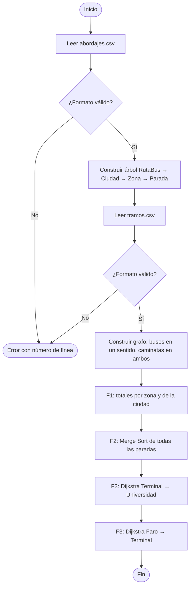
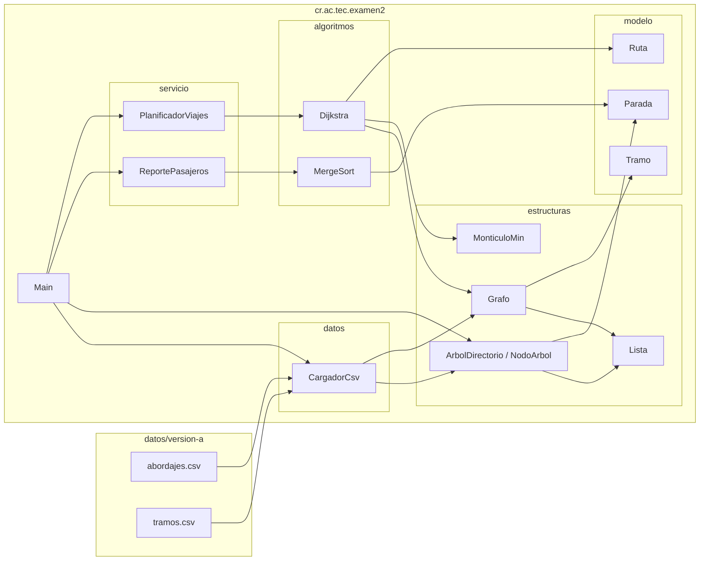
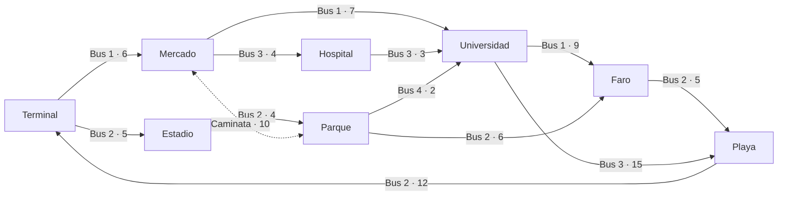

# RutaBus, planificador de viajes urbano

Examen 2 – Algoritmos y Estructuras de Datos I (CE1103), II Semestre 2026, Instituto Tecnológico de Costa Rica. Versión A.

## Autores

- Jefferson Ariel Rodriguez Madrigal
- Adriel Mendoza Baranovicht

## Requerimientos del sistema

Lista de requerimientos de la Parte 1, tal como fueron presentados.

### Requerimientos funcionales

1. Jerarquía Ciudad ← Zona ← Parada.
2. Agregar paradas a las zonas.
3. Hacer una lista de todas las paradas registradas en una zona.
4. Obtener el total de abordajes diarios de cualquier zona o de toda la ciudad.
5. Cada noche se listan las 1.200 paradas ordenadas de más a menos abordajes.
6. En caso de empates en la lista de paradas, ordenar por código de la A a la Z.
7. El tiempo de ejecución del servidor debe estar garantizado incluso para la peor entrada, ya que será compartido.
8. El pasajero debe poder seleccionar una parada de salida y un destino.
9. La app debe decirle al pasajero qué buses debe tomar para llegar lo antes posible.
10. Debe indicar si debe caminar para llegar a tomar el bus.
11. Se deberá dar al pasajero el tiempo que tardará en llegar a su destino.
12. Los buses solo pueden circular en el sentido de su línea.
13. Caminando, el pasajero puede ir en ambos sentidos a abordar los buses.

### Requerimientos no funcionales

1. Los buses solo pueden circular en el sentido de su línea.
2. En caso de empate a la hora de listar las paradas cada noche, se ordena por código de A-Z.

### Decisiones de diseño (Parte 1)

| Feature | Estructura / algoritmo | Complejidad | Alternativa descartada |
|---|---|---|---|
| F1 | Árbol n-ario de 4 niveles | O(4) | Árbol binario, ya que el árbol n-ario sirve para agrupar elementos en sus distintos niveles. |
| F2 | Merge Sort | Siempre es O(log(n)) | Insertion Sort, ya que Merge Sort es más estable en todos sus casos. |
| F3 | Grafo, Dijkstra | O((V+E) log V) | DFS, ya que solo funciona cuando los costos son iguales. |

Niveles del árbol de F1: 1) RutaBus, 2) Ciudad, 3) Zona, 4) Parada.

## Instalación y ejecución

Requisitos: JDK 26 (el proyecto compila con `maven.compiler.release` 26) y Maven 3.9 o superior.

```bash
git clone <url-de-este-repositorio>
cd <carpeta-del-repositorio>/java

mvn compile                                     # compilar
java -cp target/classes cr.ac.tec.examen2.Main  # ejecutar (lee ../datos/version-a)
mvn test                                        # ejecutar las pruebas unitarias (JUnit 5)
```

`Main` busca los datos en `../datos/version-a` o `datos/version-a`; también se le puede pasar la carpeta como argumento:

```bash
java -cp target/classes cr.ac.tec.examen2.Main ../datos/version-a
```

Verificación de restricciones (desde la raíz del repositorio):

```bash
./scripts/verificar-restricciones.sh
```

### Salida del programa

```
--- F1. Total de abordajes por zona y de la ciudad ---
Centro: 3810 abordajes  [Terminal, Mercado, Hospital]
Norte: 2745 abordajes  [Universidad, Estadio, Parque]
Costa: 1280 abordajes  [Faro, Playa]
Ciudad: 7835 abordajes

--- F2. Reporte de pasajeros ---
   1. S01 Terminal     Centro     1520
   2. S03 Universidad  Norte      1310
   3. S08 Hospital     Centro     1310
   4. S02 Mercado      Centro      980
   5. S05 Estadio      Norte       980
   6. S04 Faro         Costa       640
   7. S07 Playa        Costa       640
   8. S06 Parque       Norte       455

--- F3. Planificador de viajes ---
Viaje de Terminal a Universidad: 11 minutos
  - Tomar Bus 2 de Terminal a Parque (9 min)
  - Tomar Bus 4 de Parque a Universidad (2 min)
  Debe caminar: no

Viaje de Faro a Terminal: 17 minutos
  - Tomar Bus 2 de Faro a Terminal (17 min)
  Debe caminar: no
```

## Jerarquía de carpetas

```
.
├── README.md
├── PROMPTS.md                      Registro textual de los prompts enviados a la IA
├── datos/version-a/                abordajes.csv y tramos.csv (datos del examen)
├── scripts/verificar-restricciones.sh
└── java/
    ├── pom.xml
    └── src/
        ├── main/java/cr/ac/tec/examen2/
        │   ├── Main.java
        │   ├── modelo/        Parada, Tramo, Ruta
        │   ├── estructuras/   Lista, NodoArbol, ArbolDirectorio, MonticuloMin, Grafo
        │   ├── algoritmos/    MergeSort, Dijkstra
        │   ├── servicio/      ReportePasajeros, PlanificadorViajes
        │   └── datos/         CargadorCsv
        └── test/java/cr/ac/tec/examen2/
            ├── DirectorioParadasTest.java   RF 1–4
            ├── ReportePasajerosTest.java    RF 5–7, RNF 2
            ├── PlanificadorViajesTest.java  RF 8–13, RNF 1
            ├── CargadorCsvTest.java         Datos mal formados
            ├── EstructurasTest.java         Lista y MonticuloMin
            ├── DatosPrueba.java             Carga de los CSV para las pruebas
            └── SmokeTest.java               Prueba base del repositorio
```

### Módulos y clases

| Clase | Qué hace |
|---|---|
| `Main` | Carga los CSV y ejecuta lo pedido: totales por zona y ciudad, reporte de pasajeros, viajes Terminal → Universidad y Faro → Terminal. |
| `modelo.Parada` | Parada con código, nombre, zona y abordajes diarios; valida los datos. |
| `modelo.Tramo` | Arista dirigida: línea (o `Caminata`), origen, destino y minutos. |
| `modelo.Ruta` | Resultado del planificador: tramos, buses a tomar, si hay que caminar, minutos totales e instrucciones. |
| `estructuras.Lista` | Lista dinámica propia sobre un arreglo (sustituye a `java.util`). |
| `estructuras.NodoArbol` | Nodo del árbol n-ario con su nivel (RutaBus, Ciudad, Zona, Parada) e hijos. |
| `estructuras.ArbolDirectorio` | F1: árbol de 4 niveles; agrega paradas, lista paradas por zona y suma abordajes de una zona o de la ciudad. |
| `estructuras.MonticuloMin` | Montículo binario de mínimos propio, cola de prioridad de Dijkstra. |
| `estructuras.Grafo` | Grafo dirigido y ponderado con listas de adyacencia; buses en un sentido, caminatas en ambos. |
| `algoritmos.MergeSort` | F2: Merge Sort propio (más a menos abordajes, empates por código A-Z); cuenta comparaciones. |
| `algoritmos.Dijkstra` | F3: ruta de llegada más temprana con montículo de mínimos. |
| `servicio.ReportePasajeros` | F2: genera y formatea el reporte nocturno. |
| `servicio.PlanificadorViajes` | F3: valida la salida y el destino y devuelve la ruta. |
| `datos.CargadorCsv` | Lee `abordajes.csv` y `tramos.csv`; rechaza encabezados, columnas o números mal formados indicando la línea. |

## Requerimientos desarrollados por los estudiantes

Todos los requerimientos se implementaron y tienen pruebas; ninguno se excluyó.

| Requerimiento | Estado | Implementación | Pruebas |
|---|---|---|---|
| RF 1 | Implementado | `ArbolDirectorio`, `NodoArbol` | `DirectorioParadasTest.rf01*` |
| RF 2 | Implementado | `ArbolDirectorio.agregarParada` | `DirectorioParadasTest.rf02*` |
| RF 3 | Implementado | `ArbolDirectorio.listarParadas` | `DirectorioParadasTest.rf03*` |
| RF 4 | Implementado | `ArbolDirectorio.totalAbordajesZona/Ciudad` | `DirectorioParadasTest.rf04*` |
| RF 5 | Implementado | `ReportePasajeros`, `MergeSort` | `ReportePasajerosTest.rf05*` |
| RF 6 | Implementado | `MergeSort.comparar` | `ReportePasajerosTest.rf06*` |
| RF 7 | Implementado | `MergeSort` (sin dependencia del orden de entrada) | `ReportePasajerosTest.rf07*` |
| RF 8 | Implementado | `PlanificadorViajes.planificar` | `PlanificadorViajesTest.rf08*` |
| RF 9 | Implementado | `Dijkstra`, `Ruta.getBuses` | `PlanificadorViajesTest.rf09*` |
| RF 10 | Implementado | `Ruta.requiereCaminar`, `Ruta.getInstrucciones` | `PlanificadorViajesTest.rf10*` |
| RF 11 | Implementado | `Ruta.getMinutos` | `PlanificadorViajesTest.rf11*` |
| RF 12 | Implementado | `Grafo.agregarTramoBus` (arista dirigida) | `PlanificadorViajesTest.rf12*` |
| RF 13 | Implementado | `Grafo.agregarCaminata` (dos aristas) | `PlanificadorViajesTest.rf13*` |
| RNF 1 | Implementado | `Grafo.agregarTramoBus` | `PlanificadorViajesTest.rnf01*` |
| RNF 2 | Implementado | `MergeSort.comparar` | `ReportePasajerosTest.rnf02*` |

Cada requerimiento funcional tiene al menos una prueba de valor exacto, casos límite (zona vacía, origen igual al destino, empates) y entradas inválidas (parada o zona inexistente, datos mal formados).

## Diagramas

### Diagrama de flujo



### Diagrama de componentes



### Diagrama del grafo

Aristas dirigidas para los buses (solo en el sentido de su línea) y en ambos sentidos para la caminata; pesos en minutos.


